# Backend – Registros de Uso de Inteligência Artificial

## Descrição
Backend desenvolvido em Node.js e MariaDB para registrar e gerenciar informações sobre a utilização de Inteligência Artificial por empresas, escolas e pessoas.

O sistema permite cadastrar usuários, realizar login, registrar aplicações de IA, consultar suas finalidades e tecnologias, identificar possíveis riscos e verificar a necessidade de revisão humana.

## Diagrama de Classes (DC)

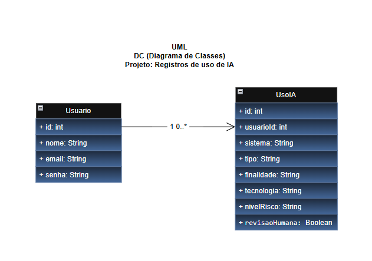

## Diagrama Entidade-Relacionamento (DER)

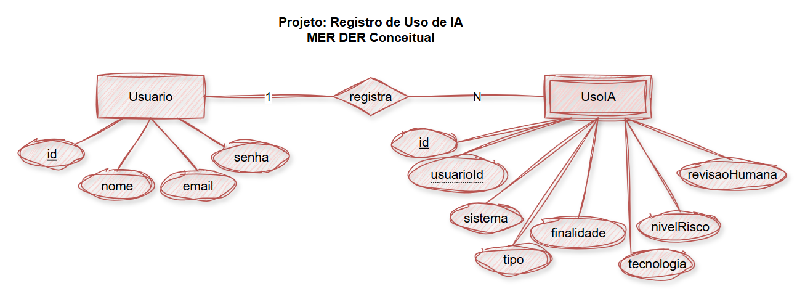

## Tecnologias utilizadas
- Node.js
- Express
- MariaDB
- MySQL2
- JavaScript
- Insomnia
- Draw.io

## Instalação e execução

1. Instalar as dependências:

```bash
npm install
```

2. Executar o script SQL localizado em `db/script.sql` no MariaDB.

3. Iniciar o servidor:

```bash
node server.js
```

4. O servidor estará disponível em:

```text
http://localhost:3000
```

## Rotas da API

### Usuários

| Método | Rota | Descrição |
|---|---|---|
| POST | /usuarios | Cadastrar usuário |
| GET | /usuarios | Listar usuários |
| GET | /usuarios/:id | Buscar usuário |
| PUT | /usuarios/:id | Atualizar usuário |
| DELETE | /usuarios/:id | Excluir usuário |
| POST | /login | Realizar login |

### Usos de IA

| Método | Rota | Descrição |
|---|---|---|
| POST | /usoia | Cadastrar uso de IA |
| GET | /usoia | Listar usos de IA |
| GET | /usoia/:id | Buscar uso de IA |
| PUT | /usoia/:id | Atualizar uso de IA |
| DELETE | /usoia/:id | Excluir uso de IA |
| GET | /usoia/resumo/riscos | Consultar resumo de riscos |

## Testes realizados no Insomnia

### 1. Cadastro de usuário
**POST /usuarios**

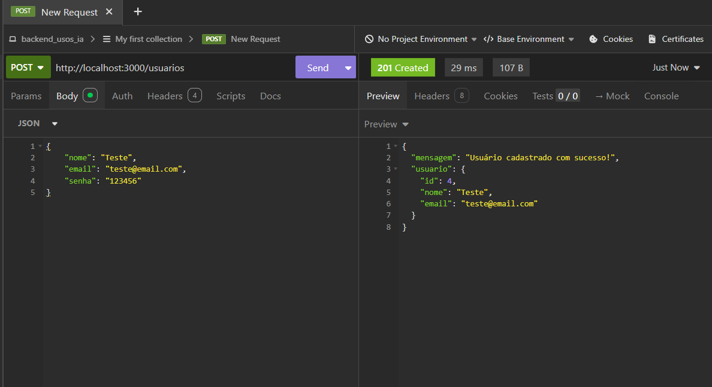

### 2. Listagem de usuários
**GET /usuarios**

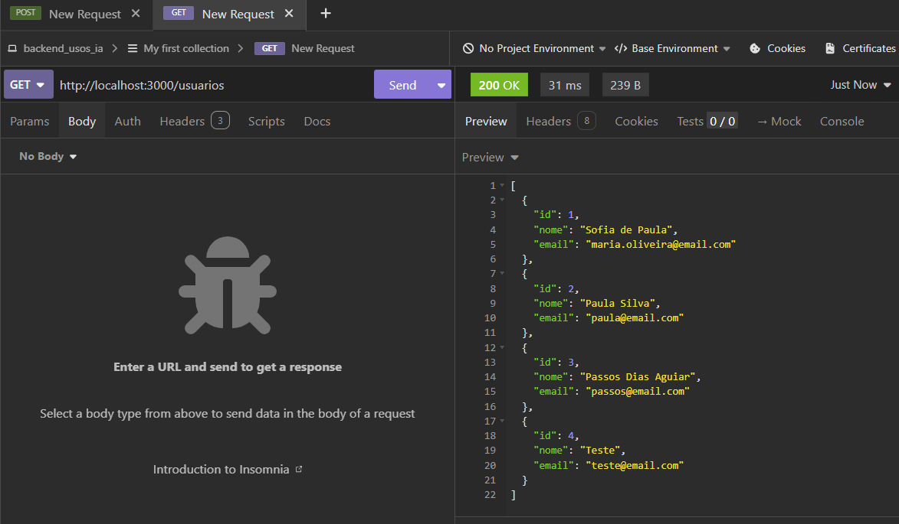

### 3. Busca de usuário por ID
**GET /usuarios/4**

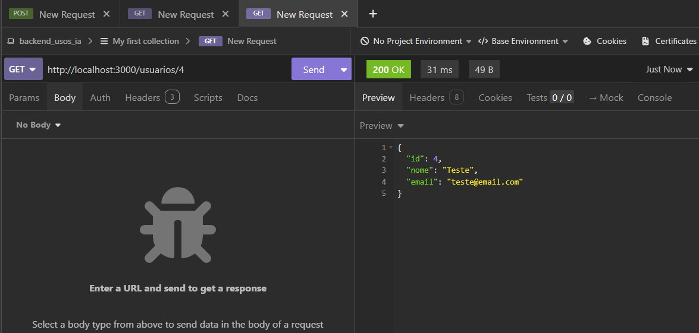

### 4. Atualização de usuário
**PUT /usuarios/4**

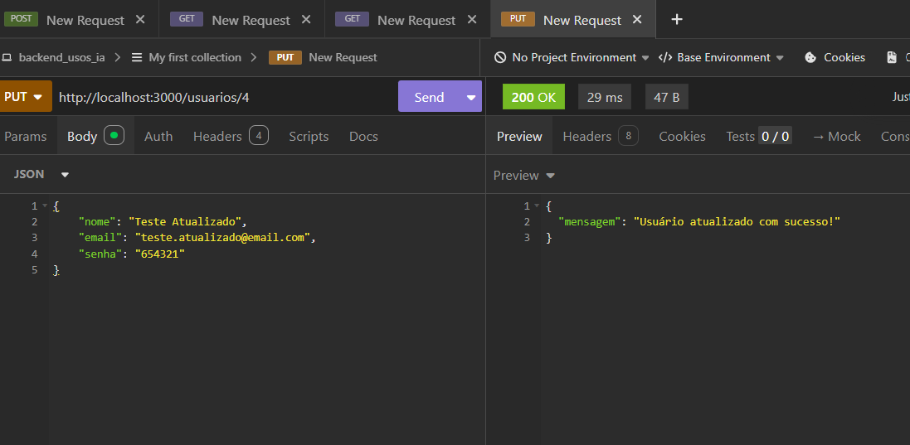

### 5. Verificação da atualização
**GET /usuarios/4**

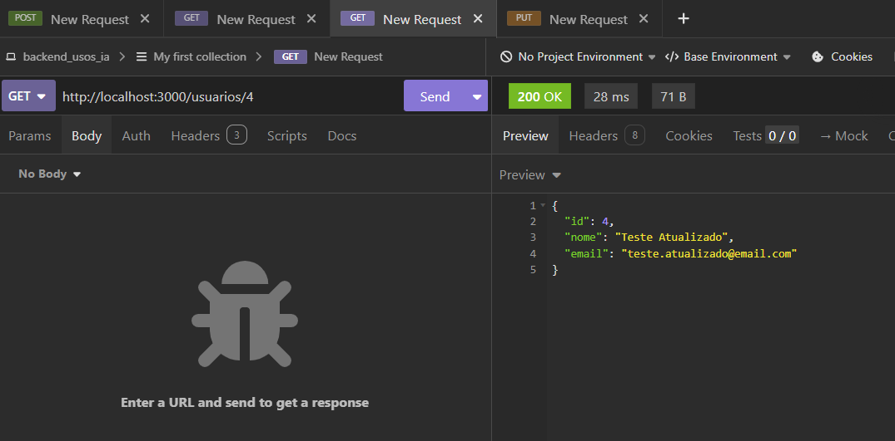

### 6. Login
**POST /login**

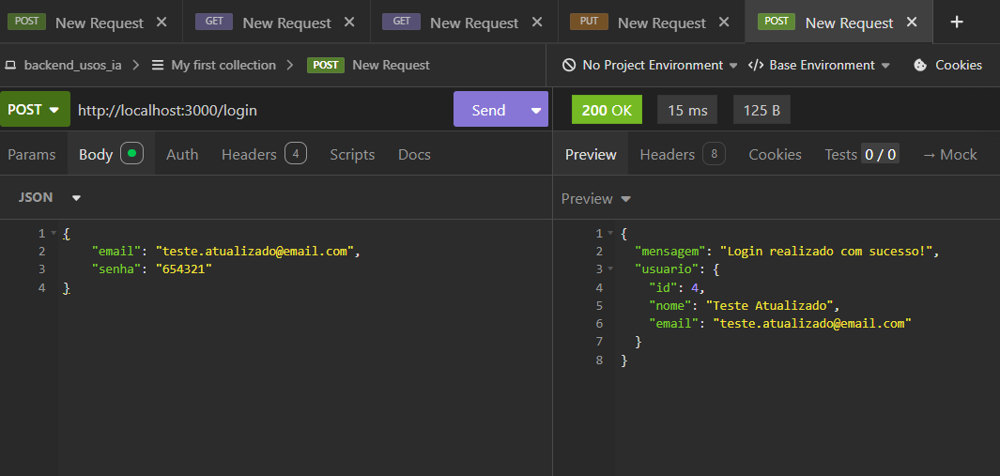

### 7. Cadastro de uso de IA
**POST /usoia**

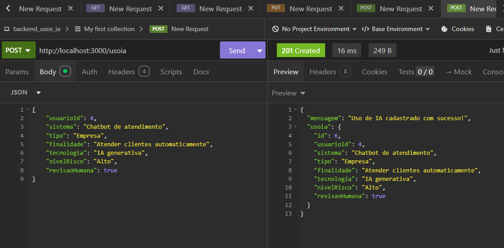

### 8. Listagem de usos de IA
**GET /usoia**

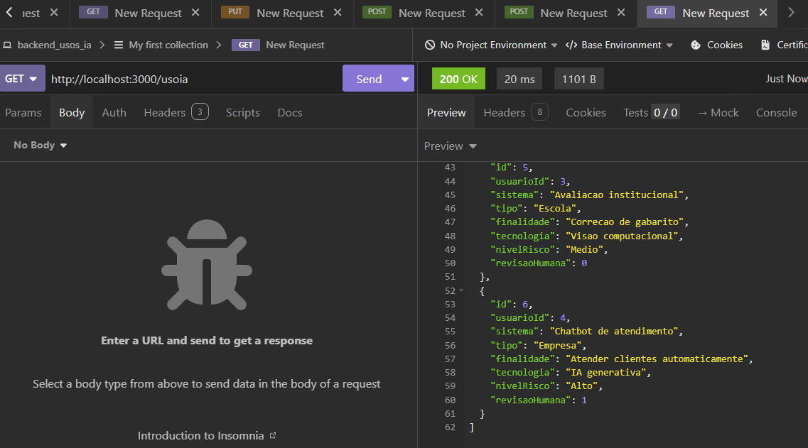

### 9. Busca de uso de IA por ID
**GET /usoia/6**

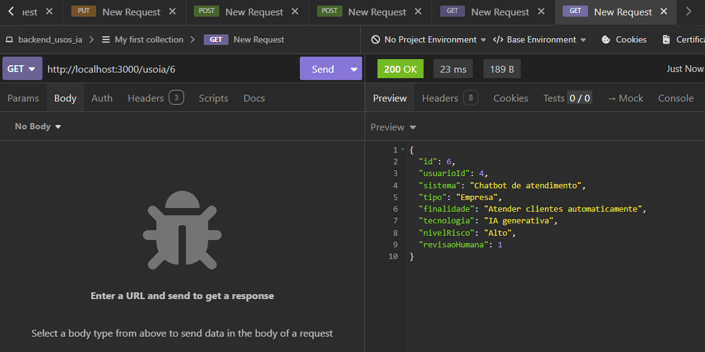

### 10. Atualização de uso de IA
**PUT /usoia/6**

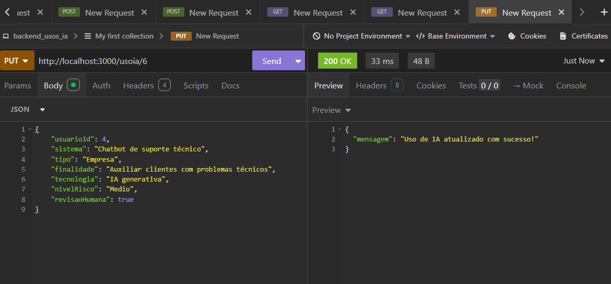

### 11. Verificação da atualização
**GET /usoia/6**

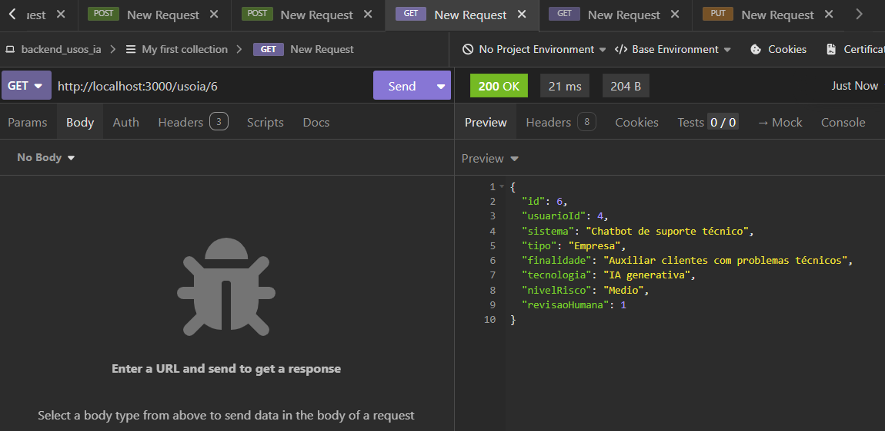

### 12. Exclusão de uso de IA
**DELETE /usoia/6**

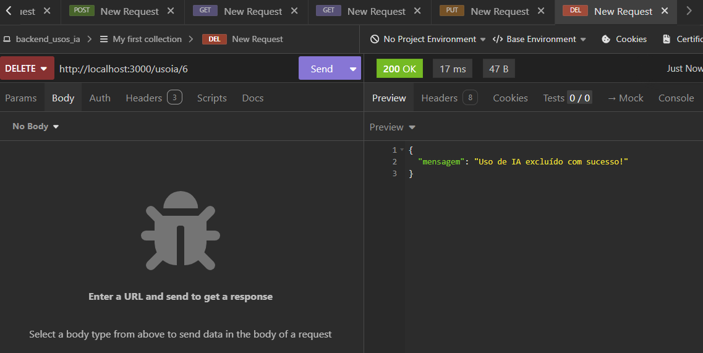

### 13. Resumo por nível de risco
**GET /usoia/resumo/riscos**

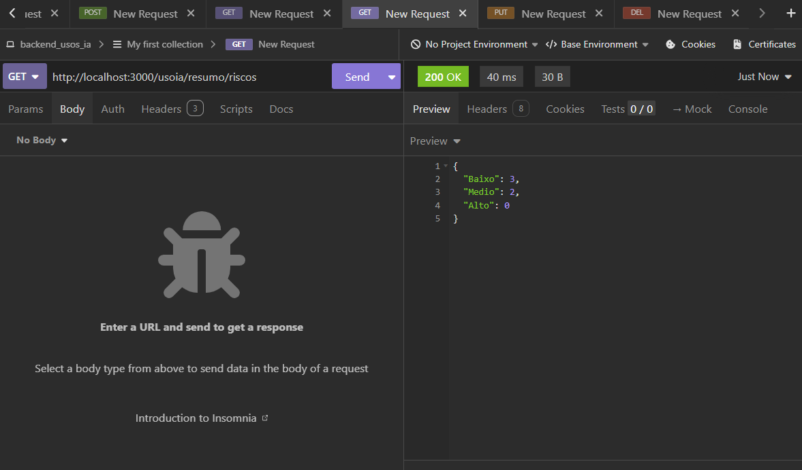

## Requisitos funcionais

- **RF001:** CRUD de usuários.
- **RF002:** Login de usuários.
- **RF003:** CRUD de registros de uso de Inteligência Artificial.
- **RF004:** Resumo da quantidade de registros por nível de risco (Baixo, Médio e Alto).

## Autor
Projeto acadêmico desenvolvido como atividade de Programação Back-End.
